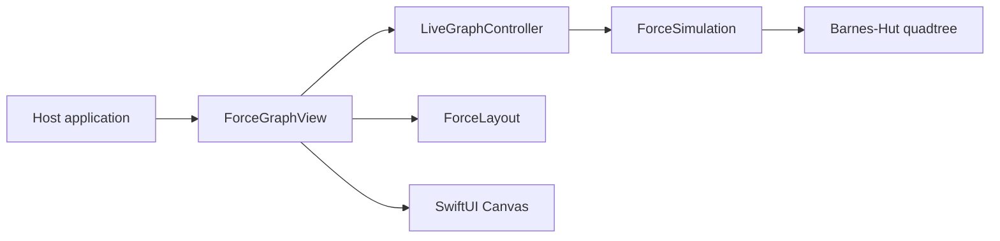

# ForceGraph contributor guide

ForceGraph is a native Swift package for graph layout and interaction. Keep code clear enough
for a junior developer to follow: descriptive names, focused functions, one abstraction level
per function, and private helpers for cohesive operations. Use protocols and types when they
clarify a domain boundary. Avoid abstractions without a concrete need. Follow .editorconfig.

## Architecture

- `Sources/ForceGraph/ForceLayout.swift`: deterministic fixed layout and streaming snapshots.
- `ForceSimulation*.swift`, `ObsidianGraphForces.swift`, and simulation helpers: the live engine,
  force configuration, graph changes, hit testing and pin/drag state. Core code uses Foundation.
- `LiveGraphController.swift`: animation lifecycle and pointer-grab semantics, independent of
  view rendering. The engine sleeps once settled and wakes for changes or dragging.
- `ForceGraphView.swift`: SwiftUI Canvas, node customization, accessibility, pan and zoom.
  The `.simulation(...)` modifier selects live interaction; existing callers retain fixed layout.
- `Tests/ForceGraphTests/`: focused Swift Testing suites for both engines and interaction state.
- `Sources/ForceGraph/ForceGraph.docc/`, `README.md`, `CHANGELOG.md`: public API documentation.
- `Scripts/check.sh`: local platform, test, performance, warning and DocC checks. No hosted CI
  or GitHub Actions. Keep source portable and preserve supported platform minimums.

## Validation and releases

Build and run focused tests incrementally. Cover new code fully with meaningful unit tests;
check coverage and report any gap explicitly. Exercise the native view in a host application
when gestures or rendering change. Run `Scripts/check.sh` before a release, and run tests with
coverage for new behavior. Update these instructions as the architecture changes.

The public repository is `ianleon/ForceGraph`. Verify the account and remote before publishing.
Do not move existing version tags. Update the changelog and documentation with each release.
