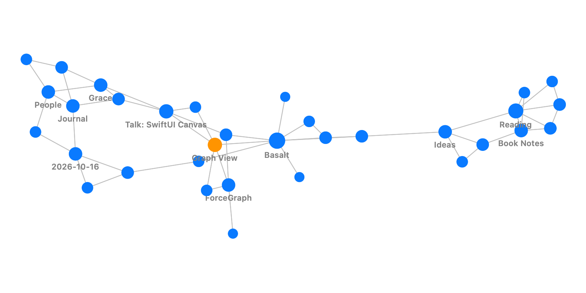

# ForceGraph

[](https://swiftpackageindex.com/ianleon/ForceGraph)
[](https://swiftpackageindex.com/ianleon/ForceGraph)

A small, dependency-free force-directed graph for Swift: a deterministic
Fruchterman–Reingold layout you can run anywhere, and a SwiftUI `Canvas` view
that animates the layout settling, with pan, zoom, fit-to-view and tap handling.



Extracted from Basalt, a Markdown notes app, where it draws the note graph.

- `ForceGraphView`: iOS 17, macOS 14 and visionOS 1. `ForceLayout` also builds for
  tvOS 16 and watchOS 9, and uses only Foundation, so it is written to build on Linux
  too (not yet tested there).
- Requires the Swift 6.0 toolchain (Xcode 16 or later); Swift 6 language mode.
- `ForceLayout` has no UI dependency — drive a `Canvas`, an AppKit view, or a test with it.
- O(n²) per step; comfortable up to ~1,500 nodes.

## Add to a project

In Xcode: *File → Add Package Dependencies…* and enter
`https://github.com/ianleon/ForceGraph`, or in `Package.swift`:

```swift
.package(url: "https://github.com/ianleon/ForceGraph.git", .upToNextMinor(from: "0.2.0")),
```

and add `.product(name: "ForceGraph", package: "ForceGraph")` to your target's
dependencies. Until 1.0, minor versions may contain breaking changes, so
`.upToNextMinor` keeps you on the version you tested; see [CHANGELOG.md](CHANGELOG.md).

For local development, add the folder with *Add Local…* or `.package(path: "../ForceGraph")`.

## Use

```swift
import SwiftUI
import ForceGraph

struct NotesGraph: View {
    let titles: [String]
    let links: [GraphEdge<String>]
    @State private var selected: String?

    var body: some View {
        ForceGraphView(nodes: titles, edges: links) { tapped in
            selected = tapped
        }
        .nodeLabel { $0 }
        .nodeColor { $0 == selected ? .orange : nil }
    }
}

#Preview {
    NotesGraph(
        titles: ["Inbox", "Projects", "Ideas", "Reading"],
        links: [GraphEdge("Inbox", "Projects"), GraphEdge("Projects", "Ideas"), GraphEdge("Ideas", "Reading")]
    )
}
```

Edges are undirected: `GraphEdge(a, b)` links two node IDs, and duplicate or
reversed pairs (`(a, b)` and `(b, a)`) are drawn and simulated once. The trailing
closure receives the tapped node.

Customize nodes with modifiers applied directly to `ForceGraphView`:
`.nodeLabel` for the text under a node, `.nodeColor` to colour nodes individually
(a selection, a category) and `.nodeRadius` to size them. Each closure may return
`nil` to keep the default: no label, `style.nodeColor`, and a radius that grows with
the node's degree. Pass a `ForceGraphStyle` for colours, label font, zoom limits and
fit padding, and a `ForceLayoutConfiguration` for the simulation (iterations, area,
gravity, seed); both have memberwise initializers, so
`style: ForceGraphStyle(minimumLabelSpacing: 24)` changes just one value.

The view fits the graph to its bounds while it animates and whenever the view
resizes, until the user pans or zooms. Double-tap fits it again, or change the
`fitTrigger:` value to fit from a toolbar button or shortcut. Zoom limits
(`minimumZoom`, `maximumZoom`) are multiples of the fitted scale.

Labels appear once nodes are far enough apart on screen (`minimumLabelSpacing`,
48 pt by default). On dense graphs they stay hidden until you zoom in; lower
`minimumLabelSpacing` (say to 24) to show them sooner.

When `nodes` or `edges` change, the view keeps the current positions and lets the
layout absorb the change, so adding a note does not scramble the graph. Changing
the `configuration`, or giving the view a new `.id(_:)`, lays it out from scratch.

Pass `nodes` in a stable order: node order seeds the layout, so an array built
from a `Set` would give a different picture on every launch.

Input: drag to pan, pinch to zoom, double-tap to fit. On macOS that means a mouse
drag and a trackpad pinch; scroll-wheel panning and keyboard zoom are not supported yet.
For VoiceOver, every node is an element named by its label (or its ID's description),
and the graph has a "Fit to view" action. Those strings are looked up in your app's
main bundle, so you can translate them in your own string catalog.

### Layout only

```swift
import Foundation  // CGPoint
import ForceGraph

let layout = ForceLayout(
    nodes: ["a", "b", "c"],
    edges: [GraphEdge("a", "b"), GraphEdge("b", "c")]
)
let positions: [String: CGPoint] = layout.run()   // synchronous, settled
```

Positions are centered on the origin in layout units; scale them to your view.
The same nodes, edges, configuration and seed always produce the same layout.

To watch it settle:

- `layout.stream()` runs on a background task and yields a snapshot every 8 steps, at
  most one per 25 ms (`minimumInterval:`, `.zero` to disable). Consume it from an async
  context: `for await snapshot in layout.stream() { … }`.
- `layout.run { snapshot in … }` reports progress synchronously, every 8 steps by
  default (`reportingEvery:`).
- `layout.makeSimulation()` returns a `Simulation` you advance yourself with `step()`,
  for a `TimelineView`, a display link or a game loop.

To update a layout after the graph changes without starting over, pass the previous
positions as `initialPositions`. Known nodes start where they were, new nodes start
next to their neighbours, and the simulation starts gently (`warmStartTemperature`)
and cools to a stop:

```swift
var next = ForceLayout(
    nodes: ["a", "b", "c", "d"],
    edges: [GraphEdge("a", "b"), GraphEdge("b", "c"), GraphEdge("c", "d")]
)
next.initialPositions = positions
let updated = next.run()
```

`layout.degrees` counts each node's distinct neighbours (the view sizes nodes with it),
and `layout.uniqueEdges` lists the edges that are simulated once duplicates, reversed
pairs, self-loops and edges to unknown nodes are dropped.

`run()` is synchronous and O(n² × iterations) — about a second for 1,500 nodes
on a Mac in a release build, longer on a phone and much longer in debug builds —
so call it off the main thread for large graphs, or use `stream()`, which runs
on a background task and paces its snapshots so the settling is visible even for
small graphs.

## Test

```sh
swift test          # unit tests
Scripts/check.sh    # the full local matrix
```

`Scripts/check.sh` runs `swift build`, `swift test` and a warnings-as-errors build,
then builds the library with `xcodebuild` for macOS and the iOS and visionOS
simulators (and the tvOS and watchOS simulators when their SDKs are installed) and
builds the DocC archive.
Derived data goes to `/tmp/ForceGraph-check`. Run it before tagging a release.

## License

MIT. See [LICENSE](LICENSE).
